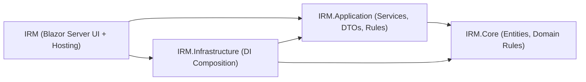

# ĐẶC TẢ KỸ THUẬT TOÀN BỘ CHỨC NĂNG HỆ THỐNG IRM

- **Phiên bản nguồn:** `custom/kh2` (kế thừa nền `v1.0.2-r6` — Web độc lập, không phụ thuộc WPF)
- **Ngày cập nhật:** 23/11/2026
- **Nền tảng:** .NET 8 · Blazor Interactive Server · MudBlazor · Entity Framework Core · SQL Server / SQLite (Test) · ClosedXML · Chart.js (offline) · Driver.js 1.12.1 (offline)
- **Đối tượng:** Lập trình viên phát triển, kiểm thử tự động (QA/TDD) và bảo trì hệ thống

---

## 1. Kiến trúc tổng thể (4-Project Clean Boundary)

Giải pháp `IRM/IRM.sln` được chia thành 4 project sản phẩm và 1 project kiểm thử, được cưỡng chế tự động bởi [ArchitectureCompatibilityTests.cs](../IRM.Tests/ArchitectureCompatibilityTests.cs):

| Project | Vai trò | Quy tắc phụ thuộc (Boundary) |
| :--- | :--- | :--- |
| **`IRM.Core`** | Entities, Value Rules (`PassportRules`, `PersonDisplayHelper`, `FieldChange`), Constants (`AdministrativeUnitTypeCodes`, `StayPurposeCodes`, `ImmigrationDocumentTypeCodes`) | **Không** tham chiếu bất kỳ project `IRM.*` nào, không tham chiếu EF Core/ASP.NET/ClosedXML |
| **`IRM.Application`** | Service Interfaces (`I*Service`), Store Abstractions (`I*Store`), Application Services (RBAC guard + DTO mapping), DTOs/Contracts, `ExcelValueNormalizer` | Chỉ tham chiếu `IRM.Core`; **không** lộ `DbContext`, `DbSet`, `IQueryable` ra bất kỳ interface nào |
| **`IRM.Infrastructure`** | `IrmDbContext`, EF Core Configurations & Migrations, SQL Stores (`Sql*Store`), ClosedXML Excel Helpers (`ExcelReader`, `ExcelWorkbookConverter`, `AdministrativeUnitExcelHelper`, `SqlExportStore`, `SqlStatisticsExportStore`), `DatabaseSeeder`, `PrivateFileStorage`, `LegacySync` | Tham chiếu `IRM.Core`, `IRM.Application`; **không** tham chiếu `IRM` (Web) |
| **`IRM`** | Blazor Interactive Server UI (`Components/`, `Features/`), `Program.cs`, `Hosting/` (Minimal APIs, Security, Maintenance CLI), `wwwroot/` (offline vendor assets, `irm-interop.js`, `import-tour.js`, `app-product-tour.js`) | Presentation + Composition Root |
| **`IRM.Tests`** | xUnit (`419 passed`, `6 SQL-Server-only skipped`) + Node.js browser/JS harness (`54/54 passed`) | Kiểm thử đầy đủ các tầng |

---

## 2. Bảo mật, Xác thực, Phân quyền (RBAC) & HTTP Endpoints

### 2.1 Cơ chế xác thực & bảo vệ
- **Cookie Authentication** (`UseAuthentication` + `UseAuthorization` + `UseAntiforgery`).
- **Tự động nâng cấp mật khẩu cũ:** `SqlAuthStore.AuthenticateWebAsync` hỗ trợ tài khoản legacy (plaintext) và tự nâng cấp sang bản băm an toàn trong `WebCredentials` ngay khi đăng nhập thành công.
- **Chống brute-force:** Khóa tài khoản 15 phút sau 5 lần đăng nhập sai liên tiếp.
- **Bắt buộc HTTPS từ máy ngoài:** Middleware trong `Program.cs` từ chối HTTP không mã hóa nếu `RemoteIpAddress` không phải loopback (cấu hình qua `Security:RequireHttpsForRemoteClients`, mặc định `true`).
- **Nhật ký kiểm toán (`AuditLogs`):** Ghi nhận thao tác nhạy cảm (đăng nhập, thêm/sửa/xóa, import/rollback, xuất báo cáo).

### 2.2 Ma trận 5 vai trò (`IrmRoles`) & Bảo vệ 2 lớp
Định nghĩa tại `IRM.Application/Abstractions/Security/IrmRoles.cs`, được cưỡng chế đồng thời ở **2 lớp**:
- **Lớp 1 — Cấp Route Blazor:** `IRM/Features/_Imports.razor` yêu cầu `@attribute [Authorize(Roles = IrmRoles.AnyUser)]` cho mọi trang nghiệp vụ; riêng `IRM/Features/Administration/Admin.razor` (`/admin`, `/admin/{SectionKey}`) khóa chặt `@attribute [Authorize(Roles = IrmRoles.Admin)]`.
- **Lớp 2 — Cấp Application Service:** `IServiceAuthorizationGuard` kiểm tra vai trò trước khi gọi xuống `IRM.Infrastructure` stores.

| Vai trò (`IrmRoles`) | Quyền chính |
| :--- | :--- |
| `ADMIN` | Toàn quyền hệ thống: quản trị tài khoản, toàn bộ danh mục (`/admin/*`), cấu hình & nạp Excel địa bàn hành chính (`/admin/admin-units`), xem Audit Log, lịch sử Import, rollback, thao tác toàn bộ nghiệp vụ |
| `DATA_EDITOR` | Thêm/sửa/xóa Hồ sơ NNN, Doanh nghiệp, Cơ sở lưu trú, Tài liệu pháp lý; thực hiện Import Excel |
| `INSPECTOR` | Tạo và cập nhật Đợt kiểm tra NNN (`/inspections`), ghi nhận đối tượng & vi phạm |
| `REPORTER` | Xem và xuất Excel Báo cáo định kỳ (`/reports`) & Thống kê địa bàn (`/statistics`) |
| `VIEWER` | Chỉ xem dữ liệu (Dashboard, Hồ sơ NNN, Doanh nghiệp, Cơ sở lưu trú, Tra cứu toàn cục, Thống kê) |

### 2.3 HTTP Minimal Endpoints (`IRM/Hosting/Endpoints.cs`)
- `GET /health/live` — Liveness probe
- `GET /health/ready` — Readiness probe (kiểm tra kết nối DB qua `IDatabaseReadiness`)
- `POST /auth/login` — Đăng nhập & cấp Auth Cookie
- `POST /auth/logout` — Đăng xuất & xóa Auth Cookie

### 2.4 Cờ CLI vận hành (`IRM/Program.cs`)
- `--export-delivery-workbooks <dir>`: xuất bộ file Excel bàn giao
- `--bootstrap`: khởi tạo schema & seed dữ liệu rồi thoát
- `--provision-database`: cấp phát DB qua `Provisioning:AdminConnectionString`
- `--backup` / `--restore`: sao lưu / khôi phục dữ liệu
- `--self-test`: chạy kiểm tra sức khỏe phát hành (`ReleaseSelfTest`)

---

## 3. Lược đồ Cơ sở dữ liệu (EF Core & Migrations)

### 3.1 Lịch sử Migrations (`IRM.Infrastructure/Persistence/Migrations/`)
1. `20260921030335_InitialSqlServerV101` — Khởi tạo toàn bộ lược đồ chuẩn hóa v1.0.1 (tương thích schema nền + các bảng mở rộng).
2. `20260927120137_AddVisaSymbol` — Bổ sung ký hiệu thị thực (`VisaSymbol`).
3. `20261122093015_MakeEmployeeCompanyNullable` — Cho phép `Employees.IDCompany` nhận `NULL` để đáp ứng quy tắc **chỉ bắt buộc Số hộ chiếu** (hồ sơ NNN có thể tạo trước khi gán doanh nghiệp).

### 3.2 Nhóm bảng dữ liệu (`IrmDbContext` — 43 `DbSet`)
- **Hồ sơ Người nước ngoài hợp nhất (Core Registry):**
  - `ForeignPersons` *(định danh duy nhất theo Số hộ chiếu chuẩn hóa `PassportSearchKey`)*
  - `ForeignPersonSourceLinks` *(liên kết sang bản ghi chi tiết `Employees` / `Students` / `FamilyVisitDetails`)*
  - `StayCases` *(hồ sơ lưu trú theo mục đích `StayPurposeCodes`: Lao động, Du học, Thăm thân... — hỗ trợ Effective Dating `ValidFrom`/`ValidTo`)*
  - `ResidencePeriods` *(quá trình cư trú gắn với `AdministrativeUnitId` và `AccommodationId`, Effective Dating)*
  - `ImmigrationDocuments` *(thị thực, thẻ tạm trú, miễn thị thực, gia hạn — kèm `VisaSymbol`, `ValidFrom`/`ValidTo`)*
  - `ElectronicIdentities` *(mã định danh điện tử mức 1/2)*
  - `Employees`, `Students`, `FamilyVisitDetails` *(chi tiết theo từng diện)*
- **Doanh nghiệp & Cơ sở lưu trú:**
  - `Companies`, `CompanyProfiles` *(loại hình FDI/trong nước, trạng thái pháp nhân)*, `CompanySites` *(trụ sở/chi nhánh gắn `AdministrativeUnitId` theo mốc thời gian)*, `CompanyRepresentatives`, `CompanyLegalDocuments`, `StoredFiles`
  - `Investments`, `PhoneNumbers`, `Emails`, `Attachments`
  - `Accommodations` *(khách sạn, nhà trọ, KTX gắn `AdministrativeUnitId`)*, `CompanyAccommodationAgreements` *(hợp đồng thuê chỗ ở giữa doanh nghiệp & CSLT)*
  - `EconomicZones`, `SiteZoneMemberships` *(khu công nghiệp / khu kinh tế)*
- **Giám sát & Kiểm tra:**
  - `Inspections`, `InspectionSubjects`
- **Danh mục & Địa bàn hành chính:**
  - `AdministrativeUnits` *(Unique Index trên `(Code, ValidFrom)`, hỗ trợ `ParentId`, `PredecessorId`, `ValidFrom`, `ValidTo`, `IsDeleted`)*
  - `Nationality`, `Fields`, `CareerGroups`, `Careers`, `Districts`, `Wards`
- **Import, Kiểm toán & Hệ thống:**
  - `Accounts`, `WebCredentials`, `WebRoleAssignments`, `AuditLogs`
  - `ImportHistories`, `ImportBackups`, `ArchivedEmployees`, `ColumnMappingTemplates`
  - `SchemaVersions`, `LegacyChangeEvents`, `MigrationIssues`

---

## 4. Quy tắc nghiệp vụ cốt lõi (Áp dụng xuyên suốt toàn ứng dụng)

### 4.1 Quy tắc "Chỉ bắt buộc Số hộ chiếu" (Passport-Only Mandatory Rule)
- **Nguyên tắc:** Mọi hồ sơ Người nước ngoài (nhập tay tại `/foreign-persons`, `/employees`, `/students`, `/family-visitors` hoặc nhập hàng loạt tại `/import`) **PHẢI có Số hộ chiếu** — đây là trường định danh bắt buộc duy nhất; các trường khác (`Họ tên`, `Ngày sinh`, `Quốc tịch`, `Công ty`, `Địa chỉ`, `Số điện thoại`...) đều cho phép để trống và bổ sung sau.
- **Chuẩn hóa định danh:** `PassportRules` loại bỏ khoảng trắng/ký tự thừa; các chuỗi không chứa chữ/số (VD `"---"`) bị coi là rỗng/không hợp lệ.
- **Hiển thị an toàn khi thiếu Họ tên/Công ty:** `PersonDisplayHelper.FormatName(fullName, passport)` tự động fallback sang Số hộ chiếu khi chưa có họ tên; toàn bộ các màn hình downstream (Dashboard, Search, Reports, Inspections, Statistics, Export) xử lý null-safe cho `IDCompany == null` và tên trống.
- **Nhắc nhở giao diện (3 lớp):**
  - Banner cảnh báo đầu mọi trang (`data-passport-required-notice="true"` trong `MainLayout.razor`, có nút đóng và lưu trạng thái vào `localStorage['irm-passport-notice-dismissed']`).
  - Banner nhắc tại Bước 1 Upload Excel (`ImportUploadSection.razor`).
  - Banner nhắc đầu hộp thoại thêm/sửa hồ sơ NNN (`ForeignPersons.razor`).

### 4.2 Quy tắc chuẩn ngày tháng `dd/MM/yyyy`
- Mọi `MudDatePicker` và ô nhập ngày từ Excel đều dùng chuẩn duy nhất **`dd/MM/yyyy`**.
- `ExcelValueNormalizer` chuẩn hóa chuỗi ngày đầu vào về `dd/MM/yyyy` và từ chối/cảnh báo các định dạng mơ hồ hoặc sai chuẩn (VD `yyyy-MM-dd` trong nạp địa bàn Excel bị báo lỗi yêu cầu `dd/MM/yyyy`).

---

## 5. Đặc tả chi tiết theo từng phân hệ chức năng

### 5.1 Thanh điều hướng, Giao diện chung & Product Tour
- **Tệp chính:** `MainLayout.razor`, `NavMenu.razor`, `App.razor`, `SpotlightSearch.razor`, `wwwroot/js/app-product-tour.js`, `wwwroot/irm-interop.js`.
- **Chức năng:**
  - **Product Tour toàn hệ thống (`window.irmAppTour` — Driver.js 1.12.1 offline):**
    - Tự chạy 1 lần khi người dùng đăng nhập lần đầu (`localStorage` key `irm-product-tour-v1-seen`); có thể mở lại bất cứ lúc nào qua nút `#btnAppUserGuide` (**Hướng dẫn sử dụng**) trên thanh trên cùng.
    - **Bước 1 dành riêng cho `ADMIN`:** `[data-app-tour="admin-system"]` (nằm trong `<AuthorizeView Roles="ADMIN">`) hướng dẫn thiết lập **Quản trị hệ thống & Danh mục** trước tiên. Người dùng không có quyền Admin sẽ tự động bỏ qua Bước 1 và bắt đầu ngay tại **Bảng điều khiển**.
    - **Thứ tự các bước tiếp theo khớp 100% thứ tự Sidebar từ trên xuống dưới:** `nav-dashboard` → `nav-foreign-persons` → `nav-companies` → `nav-accommodations` → `nav-inspections` → `nav-search` → `nav-reports` → `nav-statistics` → `nav-import` → `#btnAppUserGuide`.
  - **Chuyển chế độ Sáng/Tối (`IrmThemeController`)** & **Mật độ bảng (Thoáng/Gọn)** lưu trên `localStorage`.
  - **Tra cứu nhanh `Ctrl+K`** (`SpotlightSearch.razor`).

### 5.2 Bảng điều khiển (`/`)
- **UI:** `IRM/Features/Reports/Home.razor`
- **Service / Store:** `IDashboardService` → `SqlDashboardStore`
- **Chức năng:**
  - Hiển thị các thẻ KPI (Tổng doanh nghiệp, NNN đang quản lý, Thăm thân, CSLT, cảnh báo hạn tạm trú/visa).
  - Biểu đồ phân bố theo Quốc tịch / Công ty / Xu hướng bằng Chart.js (offline, tự đồng bộ bảng màu theo Light/Dark theme).
  - Các nút điều hướng nhanh tới các phân hệ nghiệp vụ.

### 5.3 Hồ sơ Người nước ngoài hợp nhất (`/foreign-persons`, `/employees`, `/students`, `/family-visitors`)
- **UI:** Cả 4 route đều trỏ về duy nhất trang hợp nhất `IRM/Features/ForeignPersons/ForeignPersons.razor` *(các file cũ `Employees.razor`, `Students.razor`, `FamilyVisitors.razor` không còn `@page` route)*.
- **Services / Stores:**
  - `IForeignerRegistryService` → `SqlForeignerRegistryStore`
  - `IEmployeeService` → `SqlEmployeeStore`
  - `IStudentService` → `SqlStudentStore`
  - `IResidenceService` → `SqlResidenceStore`
- **Chức năng:**
  - Quản lý hợp nhất 1 người nước ngoài trên 1 hồ sơ đa năng (5 tab trong hộp thoại):
    1. Thông tin chung & Cư trú (Số hộ chiếu bắt buộc, Họ tên, Giới tính, Ngày sinh `dd/MM/yyyy`, Quốc tịch, Địa bàn hành chính, CSLT).
    2. Diện lưu trú (`StayCase`: Lao động / Du học / Thăm thân / Khác) & Doanh nghiệp bảo lãnh (tùy chọn).
    3. Giấy tờ xuất nhập cảnh (`ImmigrationDocuments`: Visa, Ký hiệu thị thực, Thẻ tạm trú, thời hạn).
    4. Định danh điện tử (`ElectronicIdentities`).
    5. Lịch sử cư trú & lưu trú theo mốc thời gian.
  - Bộ lọc theo diện, tìm kiếm theo hộ chiếu/tên, phân trang `MudDataGrid` (`PageSizeOptions` bao gồm `15`), cột thao tác sticky responsive.

### 5.4 Doanh nghiệp (`/companies`, `/company-profiles`)
- **UI:** `IRM/Features/Companies/Companies.razor`, `CompanyProfiles.razor`
- **Services / Stores:** `ICompanyService` (`SqlCompanyStore`), `ICompanyProfileService` (`SqlCompanyProfileStore`), `ILegalDocumentService` (`SqlLegalDocumentStore`, `PrivateFileStorage`, `IMalwareScanner`, `IStorageCapacityGuard`).
- **Chức năng:**
  - CRUD Doanh nghiệp, phân loại hình sở hữu (FDI/Trong nước), lĩnh vực, vốn đầu tư, thông tin liên hệ.
  - Quản lý địa điểm hoạt động (`CompanySites` gắn `AdministrativeUnitId` & `EconomicZone`), người đại diện (`CompanyRepresentatives`), và hồ sơ pháp lý đính kèm (`CompanyLegalDocuments` + `StoredFiles` lưu an toàn ngoài `wwwroot`).

### 5.5 Cơ sở lưu trú (`/accommodations`)
- **UI:** `IRM/Features/Accommodations/Accommodations.razor`
- **Service / Store:** `IAccommodationService` → `SqlAccommodationStore`
- **Chức năng:**
  - CRUD Cơ sở lưu trú (khách sạn, nhà nghỉ, nhà trọ, KTX) gắn với `AdministrativeUnitId`.
  - Quản lý thỏa thuận thuê chỗ ở giữa Doanh nghiệp và CSLT (`CompanyAccommodationAgreements` theo mốc `ValidFrom`/`ValidTo`) và đếm số NNN đang cư trú hiện tại.

### 5.6 Đợt kiểm tra NNN (`/inspections`)
- **UI:** `IRM/Features/Inspections/Inspections.razor`
- **Service / Store:** `IInspectionService` → `SqlInspectionStore`
- **Chức năng:**
  - Tạo, lọc và cập nhật đợt kiểm tra hiện trường gắn với `AdministrativeUnitId`, đơn vị chủ trì, ngày kiểm tra (`dd/MM/yyyy`).
  - Gán danh sách đối tượng NNN (`InspectionSubjects`), ghi nhận kết quả kiểm tra và vi phạm (nếu có).

### 5.7 Tra cứu toàn cục (`/search`)
- **UI:** `IRM/Features/Reports/Search.razor`
- **Service / Store:** `ISearchService` → `SqlSearchStore`
- **Chức năng:**
  - Tìm kiếm đa tiêu chí trên toàn hệ thống (Số hộ chiếu, Họ tên, Quốc tịch, Công ty, Địa bàn, Thời hạn giấy tờ/tạm trú) và xem nhanh hồ sơ liên quan.

### 5.8 Báo cáo định kỳ (`/reports`)
- **UI:** `IRM/Features/Reports/Reports.razor`
- **Service / Store:** `IExportService` → `SqlExportStore`
- **Chức năng:**
  - Report Builder cho phép chọn bộ lọc, tùy chọn cột hiển thị, gom nhóm theo Công ty / Quốc tịch / Lĩnh vực, và xuất file Excel `.xlsx` (qua `irmInterop.downloadFile`).

### 5.9 Thống kê Lịch sử & Địa bàn (`/statistics`)
- **UI:** `IRM/Features/Reports/Statistics.razor`
- **Services / Stores:** `IStatisticsService` (`SqlStatisticsStore`), `IStatisticsExportService` (`SqlStatisticsExportStore`).
- **Chức năng:**
  - **Hoàn toàn động theo danh mục `AdministrativeUnits` do `ADMIN` cấu hình** (đã gỡ bỏ hoàn toàn con số cứng `54` trên toàn UI & Tour); hiển thị nút **Cấu hình địa bàn** (`/admin/admin-units`) cho `ADMIN`.
  - Truy vấn theo mốc thời gian (`AsOfDate` / khoảng ngày — Effective Dating), tính tổng số NNN duy nhất theo `ForeignPersonId` để không đếm trùng.
  - 4 góc nhìn phân tích:
    1. Thống kê chi tiết 1 địa bàn (NNN theo mục đích lưu trú, Doanh nghiệp, CSLT trên địa bàn).
    2. **Tổng quan toàn bộ địa bàn** (`@_overview.Count` đơn vị thực tế trong DB).
    3. **Định danh điện tử & Giấy tờ** (đã/chưa có định danh điện tử, phân loại giấy tờ).
    4. **Khu & Cụm kinh tế** (`EconomicZones`).
  - Xuất báo cáo tổng hợp ra Excel `.xlsx`.

### 5.10 Nhập dữ liệu Excel & Bộ chuyển đổi chuẩn hóa (`/import`)
- **UI:** `IRM/Features/ImportExport/Import.razor`, `Import.razor.cs` và các section con (`ImportPreparationSection`, `ImportUploadSection`, `ImportMappingSection`, `ImportPreviewSection`, `ImportResultSection`) + hướng dẫn tương tác `wwwroot/js/import-tour.js`.
- **Services / Stores / Engine:**
  - `IImportService` → `ImportApplicationService` → `SqlImportStore` (`.Preview.cs`, `.Comparison.cs`, `.ExtensionHistory.cs`)
  - `IExcelReader` (`ExcelReader`), `IExcelWorkbookConverter` (`ExcelWorkbookConverter`), `ExcelValueNormalizer`
- **Quy trình 5 bước:**
  1. **Chuẩn bị file:** Tải file mẫu chuẩn IRM, xem hướng dẫn cột bắt buộc (`Số hộ chiếu`).
  2. **Tải file (`.xlsx`):** Chọn file, chọn Sheet, chọn Công ty mặc định (tùy chọn), Template ghép cột, Nhóm nghề (tùy chọn).
  3. **Ghép cột & Chuẩn hóa trực tiếp (Step 2 Converter):**
     - Tự động nhận diện cột nguồn kể cả file nhiều cột lộn xộn; lưu/nạp `ColumnMappingTemplates`.
     - **Chuẩn hóa dữ liệu xác định (`ExcelValueNormalizer`):** giữ nguyên chuẩn ngày **`dd/MM/yyyy`**, chuẩn hóa Quốc tịch (tên tiếng Anh/Việt → mã ISO 3 ký tự), Giới tính, Số hộ chiếu, Loại giấy tờ, Mã địa bàn.
     - **2 lớp thông báo trực tiếp (Live Notifications):**
       - *Lớp 1 (Tình trạng file mới nạp):* số cột tự ghép, số ô cần chuẩn hóa, số dòng thiếu Số hộ chiếu / sai định dạng.
       - *Lớp 2 (Sau khi chuẩn hóa/sửa đổi):* báo rõ đã chuyển đổi bao nhiêu ô và **còn thiếu/lỗi những trường nào** cần bổ sung trước khi xem trước.
     - Cho phép tải xuống file Excel đã chuẩn hóa trước khi commit.
  4. **Xem trước & So sánh (Preview):** Phân loại dòng Thêm mới / Cập nhật / Bỏ qua / Lỗi (cảnh báo trường thiếu không chặn lưu ngoại trừ thiếu **Số hộ chiếu**).
  5. **Thực thi nạp & Rollback:** Lưu lịch sử phiên (`ImportHistories`), chụp bản sao (`ImportBackups` / `ArchivedEmployees`) cho phép hoàn tác an toàn theo thứ tự ngược khi chưa có phụ thuộc mới hơn.

### 5.11 Quản trị hệ thống & Danh mục (`/admin`, `/admin/{SectionKey}`)
- **Phân quyền:** Khóa cấp route `@attribute [Authorize(Roles = IrmRoles.Admin)]` + kiểm tra vai trò tại tầng Service.
- **UI:** `IRM/Features/Administration/Admin.razor`, `Admin.razor.cs`, `Admin.Accounts.cs`, `Admin.Catalogs.cs`, `Admin.Audit.cs` và 9 component con trong `Components/Admin*Section.razor` *(đã loại bỏ `legacy-sync` / Đồng bộ DB cũ khỏi giao diện nhánh `custom/kh2`)*.
- **Services / Stores:** `IAuthService` (`SqlAuthStore`), `ICatalogService` (`SqlCatalogStore` + `AdministrativeUnitExcelHelper`), `IAuditService` (`SqlAuditStore`).
- **9 phân mục con (`/admin/{SectionKey}`):**
  1. `accounts` — Quản lý tài khoản & phân quyền 5 vai trò.
  2. `fields` — Danh mục Lĩnh vực.
  3. `careers` — Danh mục Ngành nghề & Nhóm nghề.
  4. `nationalities` — Danh mục Quốc tịch (mã ISO & tên).
  5. `districts` — Danh mục Quận / Huyện.
  6. `wards` — Danh mục Phường / Xã.
  7. **`admin-units` — Địa bàn hành chính (Cấu hình thủ công + Nạp Excel):**
     - **Dữ liệu khởi tạo:** `DatabaseSeeder.SeedCatalogsIfEmptyAsync` chỉ tạo 1 địa bàn mẫu trung tính (`DB-001`) khi bảng `AdministrativeUnits` rỗng hoàn toàn (không tự chèn lại dữ liệu mẫu địa phương khác khi khởi động lại); `LegacySyncWorker` tắt mặc định (`LegacySync:Enabled = false`). Quản trị viên có thể tự sửa/vô hiệu hóa hoặc nạp đè danh mục địa bàn của đơn vị mình qua Excel.
     - **Tự cấu hình:** Thêm / Sửa / Vô hiệu hóa (kèm `ValidFrom` chuẩn `dd/MM/yyyy`, tìm kiếm nhanh theo Mã/Tên, lọc theo Loại: Phường / Xã / Đặc khu / Tỉnh-TP); kiểm tra trùng `(Code, ValidFrom)` trả thông báo tiếng Việt rõ ràng.
     - **Nạp hàng loạt từ Excel (`.xlsx`):**
       - Nút **Tải file mẫu Excel** (`Mau-Dia-Ban-Hanh-Chinh.xlsx` — 4 cột: `Mã địa bàn`, `Tên địa bàn`, `Loại`, `Hiệu lực từ`).
       - Upload `.xlsx` → **Xem trước & kiểm tra lỗi từng dòng** (thiếu Mã/Tên, trùng Mã trong file, loại không hợp lệ, ngày sai chuẩn `dd/MM/yyyy`); bảng xem trước **ưu tiên hiển thị các dòng lỗi lên đầu** và thông báo rõ nếu file vượt quá 50 dòng hiển thị.
       - **Xác nhận nạp theo cơ chế Upsert an toàn:** ưu tiên khớp chính xác `(Code, ValidFrom)` trước rồi mới fallback theo `Code` để tránh xung đột Unique Index với bản ghi lịch sử; tự khôi phục mã từng bị vô hiệu hóa mà **không làm gãy khóa ngoại** của hồ sơ cư trú/doanh nghiệp/CSLT/đợt kiểm tra.
  8. `audit` — Tra cứu Nhật ký hệ thống theo tài khoản, hành động và khoảng thời gian (`dd/MM/yyyy`).
  9. `import-history` — Theo dõi lịch sử các phiên Import Excel và thực hiện Rollback.

---

## 6. Hạ tầng kiểm thử tự động (Test Coverage)

Mọi thay đổi mã nguồn trên nhánh `custom/kh2` phải vượt qua toàn bộ bộ kiểm thử ở cấu hình `Release` với `0 Warning(s), 0 Error(s)`:

| Bộ kiểm thử | Lệnh chạy (từ `IRM/`) | Quy mô hiện tại | Phạm vi bao phủ |
| :--- | :--- | :--- | :--- |
| **Build Release** | `dotnet build IRM.sln -c Release` | 5 project | Biên dịch + MudBlazor Analyzer (`MUD0002`...) |
| **.NET xUnit Suite** | `dotnet test IRM.Tests/IRM.Tests.csproj -c Release --no-build` | **419 Passed**, 0 Failed, 6 Skipped (SQL Server integration) | 54 file test: Architecture boundaries, RBAC/Auth, Passport-only rules (Schema, Manual, Import, Downstream), `ExcelValueNormalizer` (gồm cột > 26 `AA/AB`), `ExcelWorkbookConverter`, `AdministrativeUnitExcelHelper` & Upsert, `OfflineSqlServerHardeningTests`, `OfflineDeploymentScriptTests`, Statistics, Reports, Search, Inspections, Accommodations, Companies, Unified ForeignPersons, Markup guards (`AppProductTourMarkupTests`, `DynamicAdminUnitsMarkupTests`) |
| **Node.js Browser/JS Suite** | `node --test IRM.Tests/Browser/*.test.cjs` | **54/54 Passed** | 6 file test: `app-product-tour.test.cjs`, `feedback-spotlight.test.cjs`, `import-tour.test.cjs`, `responsive-table.test.cjs`, `theme-chart.test.cjs`, `theme-preference.test.cjs` |

---

## 7. Chuẩn triển khai Offline & Bảo vệ Runtime (SQL Server / Blazor Server)

### 7.1 Đảm bảo 100% Air-Gapped (Không phụ thuộc Internet)
- **Tài nguyên tĩnh nội bộ:** Toàn bộ CSS/JS/Fonts/Icons/Charts/Tour (`MudBlazor`, `app.css`, `chart.umd.min.js`, `driver.js 1.12.1`, `images/*`) được đóng gói offline trong `wwwroot/` và NuGet static web assets; **0 lời gọi `http://` hoặc `https://` ra mạng ngoài**.
- **Tương thích phần cứng & phần mềm diệt virus hãng thứ 3:**
  - Bộ cài kiểm tra tối thiểu **2 luồng CPU** (không chặn cứng xung cơ bản `< 2000 MHz` của các dòng laptop/mini-PC đời mới như i5-U, N100).
  - `WindowsDefenderMalwareScanner` hỗ trợ cấu hình `Security:RequireDefenderScanner` (**mặc định `false`** trên `custom/kh2`): máy cài Bkav / Kaspersky / ESET (tắt Defender) vẫn cài đặt, vượt qua `--self-test` và tải tệp bình thường; nếu Defender đang bật và phát hiện mã độc (`ExitCode == 2`) vẫn chặn tuyệt đối; stdout/stderr được đọc bất đồng bộ để chống treo pipe.
- **Vận hành LAN & HTTPS:**
  - Mặc định `Security:RequireHttpsForRemoteClients = true` (máy chủ dùng `http://localhost:5050`, máy trạm LAN dùng `https://TEN-MAY:5443`).
  - Nếu mạng LAN nội bộ thuần không dùng chứng chỉ HTTPS, quản trị viên có thể đổi `Security:RequireHttpsForRemoteClients = false` trong `C:\ProgramData\IRM\app\appsettings.Production.json` và khởi động lại dịch vụ `IRM`.
- **Script bảo trì & phục hồi ổn định:**
  - `backup.ps1` tự `Push-Location $appRoot` để chạy thủ công từ bất kỳ thư mục nào đều đọc đúng `appsettings.Production.json`.
  - `install.ps1`, `repair.ps1`, `restore.ps1` đều dùng vòng lặp retry `/health/ready` tối đa 30 giây (15 × 2s) và kết nối thống nhất qua `127.0.0.1,14331`.
  - `deploy/database/IRM-v1.0.1-schema.sql` và `verify-installed-database.sql` đồng bộ đủ cả 3 EF Core migration (`InitialSqlServerV101`, `AddVisaSymbol`, `MakeEmployeeCompanyNullable`).

### 7.2 Bảo vệ Runtime trên SQL Server & Blazor Server
- **An toàn Migration SQL Server:** `20261122093015_MakeEmployeeCompanyNullable` chủ động `DropIndex("IX_Employees_IDCompany")` trước khi `AlterColumn` và `CreateIndex` lại sau đó ở cả `Up()` và `Down()`.
- **An toàn truy vấn & dữ liệu null/chuỗi:**
  - `SqlStatisticsStore.GetTerritoryAsync` chiếu `CompanyName` ngay trong SQL trước khi gom nhóm (không phụ thuộc navigation chưa Include).
  - `PassportRules.NormalizePassport` trả về `null` nếu chuỗi không chứa chữ cái hoặc chữ số (ngăn hash chuỗi rỗng hoặc ghi `NULL` vào `ElectronicIdentities.IdentitySearchKey`).
  - `AdministrativeUnitExcelHelper` & `SqlCatalogStore` kiểm tra giới hạn `Code.Length <= 450` (tránh lỗi cắt chuỗi `nvarchar(450)` trên SQL Server) và dùng `GroupBy` an toàn trước `ToDictionary`.
  - `SqlFamilyVisitorStore.Unified` chuẩn hóa `CompanyId <= 0` thành `null` trên mọi bảng liên quan (`Employees`, `StayCases`, `ResidencePeriods`).
- **Ổn định Blazor Server Circuit:**
  - Chặn gọi song song cùng một `IrmDbContext` tại `Statistics.razor` bằng cờ `_loading` + vô hiệu hóa nút + `try/catch`.
  - Bọc `try/catch` cho luồng đọc `OpenReadStream` (tối đa 100 MB) và kiểm tra hộ chiếu trùng tại `Import.razor.cs`.
  - Bắt đầy đủ `JSException`, `JSDisconnectedException`, `OperationCanceledException` tại `MainLayout.razor` và `Import.Guidance.razor.cs`; cô lập `localStorage` để không làm gãy phím tắt/Product Tour khi trình duyệt chặn bộ nhớ cục bộ.

